# Project 3: Search Trees Under Long-Running Churn

Team Underqualified | CS 253 / MA 253 | 21 November 2026

## 1. Team and contributions

| Member | Roll number | GitHub | Role | Module | Derivation |
| --- | --- | --- | --- | --- | --- |
| Avinash Bhadane | 250041006 | Avinashbhadane1 | Structure A | `src/structA/` | [D1](docs/derivations/D1_250041006.pdf) |
| Krish Zinzuvadiya | 250041022 | zinzuvadiyakrish-arch | Structure B | `src/structB/` | [D2](docs/derivations/D2_250041022.pdf) |
| Mallhar Totey | 250041026 | Mallhar3923V | Architect | `app/`, `include/` | [D3](docs/derivations/D3_250041026.pdf) |
| Bahiram Sai Chhagan | 250041007 | saibahiram567 | Oracle | `oracle/` | [D4](docs/derivations/D4_250041007.pdf) |
| Mayank Moyal | 250041027 | MayankMoyal | Adversary | `adversary/` | [D5](docs/derivations/D5_250041027.pdf) |
| Aditya | 250001005 | Aditya-2007-creator | Analyst | `bench/`, `results/` | [D6](docs/derivations/D6_250001005.pdf) |

The structure owners maintain their respective tree implementations and proofs.
The Architect supplies the adapter, simulator and shared interface; the Oracle
owner supplies the independent set reference and failure reducer. The Adversary
supplies workload generation and targeted measurements, and the Analyst supplies
comparative timings, rebuild predictions and aggregation.

Contribution records: Oracle [PR #8](https://github.com/MayankMoyal/DSA-Project/pull/8),
Analyst [PR #10](https://github.com/MayankMoyal/DSA-Project/pull/10), Structure B
[PR #11](https://github.com/MayankMoyal/DSA-Project/pull/11). Git history retains
individual authored commits; this report does not reattribute them.

## 2. Problem

A search tree can preserve the correct key set while becoming expensive to
search. This project keeps n live keys while repeatedly deleting a present key
and inserting an absent key, then follows average node depth over time.
The tested populations are 1,000, 2,000 and 4,000, with at least n² pairs per
trial. A pair comprises two operations. All four strategies receive the same
initial order and trace, making shape and rebuilding behavior comparable.

The main comparison is ordinary random churn. Separate exact-fit and targeted
schedules stress directional deletion and scapegoat rebuilding. Finite runs
provide empirical evidence; the exact-fit theorem is not a theorem about
ordinary fresh-key churn.

### What would count as degradation?

Consider a uniformly selected successful lookup. A node at depth d requires d+1 key visits, counting the root. Mean node depth therefore gives the expected number of visits minus one. A rising curve at constant population records a change in shape: the index contains just as many keys, but a typical lookup travels farther. Height measures the longest path and can respond differently to the same updates. Neither statistic includes the work needed to maintain the index.

At 4,000 keys, each trial contains 16 million pairs, or 32 million individual updates per strategy. A short insertion benchmark can establish initial shape but cannot answer the churn question. We examine three quantities separately: the trajectory of mean depth, work spent rebuilding, and measured time per update. A strategy can lead on one and trail on another.

## 3. Interface and invariants

Both trees store unique signed 64-bit keys (`long long` on supported builds).
The interface below defines their common behavior. [The C++ adapter](include/tree_adapter.h)
normalizes insertion, measurement, ordered traversal and validation for the simulator.

| Operation | Contract | Hibbard BST | Scapegoat tree |
| --- | --- | --- | --- |
| Insert | Add a key only if absent and report whether size increased | `insert(key)` | `insert(key)` returns void. The adapter checks the size change. |
| Erase | Remove a key only if present and return whether it was removed | `erase(key)` | `erase(key)` |
| Find | Return whether a key is present | `contains(key)` | `contains(key)` |
| Size | Return the current live-key count | `size()` | `size()` |
| Depth and height | Return mean node depth and maximum node depth in edges | `metrics()` | `depthStats()` |
| Ordered keys | Return the live keys in strictly increasing order | `inorder()` | `toVector()` |
| Validate | Verify the structure's ordering, count and applicable balance bookkeeping | `validate()` | `checkInvariants()` |

The root has depth zero. Average depth is the sum of depths divided by the
node count. The empty tree reports average depth zero and height −1.

### Structural invariants

- Every left descendant is strictly smaller than its ancestor and every
  right descendant is strictly greater. All live keys are reachable from
  the root and their count equals `size()`.
- Structure A performs iterative BST updates and supports always-successor
  or randomized predecessor/successor replacement on two-child deletions.
- Structure B uses α = 0.7 in the simulator. A sufficiently deep insertion
  causes an ancestor subtree to be rebuilt. A deletion that drops the
  size below α times the recorded maximum triggers a whole-tree rebuild.
  Between rebuilds, the height bound uses that recorded maximum. A local
  α-weight imbalance can exist between rebuilds. Both rebuild methods
  preserve ordering and the live set.

### Churn simulator contract

The [adversary contract](adversary/CONTRACT.md) defines the deterministic
initial insertion order, the four workload generators and the FNV-1a trace
hash. For each pair, delete a live key, then insert a key absent after
deletion. This permits reinserting the same key in exact-fit workloads.

The simulator generates each pair once and applies it to all four trees.
The randomized deletion policy owns a separate RNG initialized from the
recorded seed. The simulator checks success and population after each update,
and compares each ordered traversal and structure check against the expected
live set at each checkpoint. Its membership flags use the finite generator
domain `[0, 16n)` and are separate from the studied trees. The standalone
sorted-array oracle audits the general signed-key interface in the integrated C++ test suite.

The CSV samples pair zero, every requested interval and the final pair.
The trace hash includes setup and all updates through that checkpoint. All
four strategies share a hash for a given checkpoint. Depth and rebuild counts
depend on the strategy. Cumulative rebuild counters exclude initialization.

| Live keys | Minimum churn pairs per strategy |
| ---: | ---: |
| 1,000 | 1,000,000 |
| 2,000 | 4,000,000 |
| 4,000 | 16,000,000 |

Use the Analyst's timed benchmark for operation latency. The application
performs validation and CSV reporting as part of its run.

## 4. Structure A

The iterative Hibbard BST stores a signed 64-bit key and two child pointers in
each node. Insert and lookup follow a single search path; duplicate insertions
leave the set unchanged. Deletion splices a node with at most one child, or
copies a successor/predecessor key and removes that replacement node.

The always-successor policy selects the least key in the right subtree. The
randomized policy uses a separate seeded random generator to choose either side.
Neither policy guarantees logarithmic height: each update or lookup costs O(h),
with worst-case h = O(n). Storage is O(n). Iterative operations and destruction
avoid recursive traversal failure on a long chain.

The invariant checker enforces inherited strict ordering bounds and counts
reachable nodes. Inorder keys are compared with the independent sorted-array
oracle. Full traversals for metrics and validation cost O(n) and are outside
benchmark timing. [D1](docs/derivations/D1_250041006.pdf) proves deletion preserves
order; the source is `src/structA/hibbard_bst.cpp`.

### Why deletion preserves the search order (D1)

For a leaf, disconnecting its parent link removes one key without moving another. For a node with one child, that child's entire subtree already satisfies the lower and upper bounds inherited from the deleted position. Splicing the child into the position preserves both bounds, including when the deleted node was the root.

For a two-child example, delete 8 from a tree with left child 4, right child 12, and 10 as the left child of 12. Copy 10 into the root and remove its old occurrence. Every key in the left subtree is below 8 and hence below 10. Every remaining right key exceeds 10 because 10 was its minimum and keys are unique. The minimum has no left child, so removing it reduces to a splice. Choosing the maximum of the left subtree gives the mirror argument. Thus both policies implement the same ordered set even though repeated choices produce different shapes.

## 5. Structure B

The scapegoat tree stores keys and child pointers, current size n and the
maximum size q since a whole-tree rebuild. Inserting deeper than
floor(log base (1/alpha) of q) triggers an ancestor search for a heavy child.
At alpha = 0.7 the selected subtree is rebuilt; deletion below alpha*q triggers
a whole-tree rebuild and resets q.

Array rebuilding flattens nodes in order and recursively chooses medians.
Stout-Warren rebuilding first rotates the tree into a vine, then compresses it
into a complete shape. Both preserve key order, but their shapes and event
counts need not match. Individual rebuilding costs O(s) for s affected nodes.
The standard update bound is amortized O(log n); a single update can cost O(n).

The implementation records local and whole-tree rebuild counts, rebuilt nodes
and Stout-Warren rotations separately. Its invariant audit checks ordering,
reachable count, q bookkeeping and the permitted height. It does not require
every subtree to remain alpha-balanced between rebuilds.
[D2](docs/derivations/D2_250041022.pdf) proves an over-deep insertion has a scapegoat.
[D6](docs/derivations/D6_250001005.pdf) discusses the actual rebuild variants and
the potential argument at alpha = 0.7.

### Finding the ancestor to rebuild (D2)

Let v be the inserted leaf at depth d. If each child on the search path had size at most alpha times its parent's size, multiplying the inequalities would give size(v) ≤ n times alpha to the power d. For d greater than log base (1/alpha) of n, that product is below one, contradicting the presence of the leaf. The implemented test uses q ≥ n, so exceeding its threshold also implies the contradiction. Walking up the insertion path therefore finds an ancestor with an overweight child.

An array rebuild stores the sorted node pointers temporarily and splits each range around a median. The vine method uses rotations: remove left links to form a sorted rightward chain, then compress that chain in passes. Both reuse the keys in sorted order. The array needs temporary storage proportional to subtree size. The in-place conversion avoids that array but spends pointer updates on rotations. The counters distinguish how often these procedures run from how many nodes they process.

## 6. The requirement beyond the lecture

The implementation compares asymmetric and randomized Hibbard deletion with
both scapegoat rebuilding methods. The application streams one common trace
through all four configurations and samples depth in edges, with root depth zero.

[D5](docs/derivations/D5_250041027.pdf) explains the restricted exact-fit result:
uniformly choose a live key, delete it and reinsert that same value. Under long-running uniform exact-fit updates, the expected average search cost for always-successor deletion is Θ(√n). The
published square-root expectation does not apply directly to biased deletion
or ordinary fresh-key churn. Eppinger provides empirical motivation for the
ordinary-churn experiment. Eppinger inserted before deleting and studied alternating replacement sides. Here deletion comes first and the symmetric policy chooses a side randomly. The shallow-node generators deliberately violate
uniform deletion by preferring shallow nodes with two children.

[D3](docs/derivations/D3_250041026.pdf) covers the conceptual B-tree height bound;
this project does not implement a B-tree. The historical reference experiments
use a perfect-leaves DSW variant and a reference Structure A extension; the
integrated analyst measurements use the team implementations. Their labels
must remain distinct.

### A multiway index as a point of comparison (D3)

In a nonempty B-tree of minimum degree t ≥ 2 and height h ≥ 1, the root has at least two children. At level i ≥ 1 there are at least 2 times t to the power (i−1) nodes, each holding at least t−1 keys. Adding the root key and summing the levels gives n ≥ 1 + 2(t to the power h − 1). Rearranging yields h ≤ log base t of ((n+1)/2). A one-node tree satisfies the same bound with h = 0. Splits, borrowing and merges preserve occupancy and equal leaf depth. Churn may change the height as population changes, but cannot produce the long one-sided chain possible in a binary search tree.

## 7. Correctness

A sorted vector gives an independent answer for signed 64-bit set membership, updates and cardinality. At every operation the harness compares each of the four strategies with that answer. Full audits compare the complete inorder sequence, check BST ordering and count, and check the scapegoat height and deletion-shrink conditions. Structure B exposes a void insertion method, so duplicate and new insertions are distinguished by post-state. The set can agree while tree depths differ.

At the tested main revision 2dcde34 the one-million-operation mixed run passed with workload seed 20261117 and randomized Hibbard policy seed 253. For ordinary churn, seed 42 passed 1, 4 and 16 million delete–insert pairs at n = 1000, 2000 and 4000 respectively across four variants. Dedicated fixtures covered boundary keys and no-op updates. In a disposable modified build, an incorrect size after erasing 17 reduced from eight operations to two. This was an intentional test of the harness. [Commands and evidence](oracle/VERIFICATION.md)

For random insertion, conditioning on the root rank gives expected internal path length P(n) = n−1 + (2/n) times the sum of P(k) for 0 ≤ k < n. The recurrence gives expected average depth 2(1+1/n)H(n)−4, asymptotically 2 ln n. Enumeration on the actual Hibbard implementation agrees for every size 1 through 8. This provides a baseline at initialization. [D4 proof by Sai](docs/derivations/D4_250041007.pdf)

### Audit schedule and failure reduction

Every mixed operation checks return values where available, size and membership
of the affected key. Full audits run for operations 1-64, every 4096th operation
and the final state; small fixtures audit every operation. This schedule is
explicit rather than claiming an exhaustive structural scan after every update.
The reducer retains the same variant/check signature and removes chunks then
individual operations. Its result is deletion-1-minimal, not globally shortest.

### Bug log

| Module | Symptom | Discovery and fix record |
| --- | --- | --- |
| Structure A | Duplicate erase definition prevented integration | Build compatibility check; fixed in `1a59bb1` |
| Adversary CLI | Numeric suffixes/signs could be accepted by permissive conversions | Malformed-argument regression checks; strict parsing in `fc51aef` |
| Oracle fault demo | Deliberately skipped size decrement for key 17 | Disposable mutation, reduced to insert/delete 17; not a production defect |

These are recorded examples, not an invented complete development history.

## 8. Adversarial inputs

The four churn generators share deterministic initial sampling, SplitMix64
workload randomness and a documented finite domain [0,16n). `random` chooses
a live deletion uniformly and an absent insertion uniformly; `exact` reinserts
the deleted key. `shallow_exact` and `shallow_fresh` choose a shallow two-child
node in an independent shape model, then reinsert the same or a fresh key.

The model scans depths 0-3 in breadth-first order and falls back to uniform
deletion. Generate an adaptive trace once and replay it identically across
strategies; the shape model is not one of the measured structures.

Insertion-only stress compares ascending, descending, alternating extremes,
reversed 32-key blocks and shuffle. Event frequency, rebuilt-node work,
rotations and time are different objectives. No tested candidate is claimed
to be a global optimum. The detailed recorded findings are preserved in
[adversary/RESULTS.md](adversary/RESULTS.md).

## 9. Predicted cost model

The Analyst prediction record is [bench/PREDICTIONS.md](bench/PREDICTIONS.md),
introduced in commit `a73595f`. It explicitly postdates earlier reference
exploration and must not be claimed as a preregistration for those data.
The report preserves this provenance; reorganizing files does not change it.

The explanatory model is path cost plus rebuilt-node cost plus miscellaneous
per-operation work. Coefficients depend on the implementation and machine;
no universal runtime ranking follows just from average depth.

At fixed population n >= 1000 and alpha = 0.7, the temporary size n-1 does not
cross the whole-tree shrink threshold, predicting zero whole-tree rebuilds.
The random-insertion approximation predicts local event rates of 2.73%, 2.42%
and 2.14% at the three sizes. `bench/predict_rate.cpp` evaluates the external-gap
depth recurrence. Prior rebuilding changes the shape distribution, so this is
a reference approximation rather than a guaranteed event rate.

### Paying for a rebuild (D6)

For a subtree of size s let m be the size of its heavier child. At alpha = 0.7, assign credit proportional to max(0, m − 2s/3) at each node. A median split leaves its heavier side at most half the subtree. A complete Stout–Warren shape leaves it at most two thirds. Either rebuild clears the accumulated credit inside that subtree. At a violating root, m > 0.7s, so that root alone holds credit proportional to at least s/30. With an appropriate constant this pays for the linear rebuild. A single update increases credit by only constant work per ancestor on a logarithmic path. For whole-tree shrinkage, q−n records deletions net of intervening insertions: when n falls below alpha times q there is enough credit to pay for rebuilding, after which q resets. This accounts for amortized cost at the principal study setting. The two-thirds argument does not extend to the follow-up DSW experiment at alpha = 0.55.

The frequency forecast asks a different question. Begin with one external gap at depth zero. Inserting a rank into a gap at depth d replaces it with two gaps at depth d+1. Under uniform random-rank insertion, the depth distribution of these gaps supplies a forecast for the next insertion. The tail beyond depths 19, 21 and 23 gives the forecast for the three populations. This approximation ignores how previous rebuilds have already changed the depth distribution. It can overestimate trigger frequency while the amortized bound still holds.

## 10. Experimental setup

The integrated analyst study uses five seeds per size, 100 checkpoints per
trial and n² pairs. Workload seed is 202611160 + 31*n + trial; randomized
replacement uses a separate derived seed. Trace hashes verify common inputs.
The timer surrounds update blocks only; setup, generation, audits and depth
scans are excluded. Time per operation divides by twice the completed pairs.
Rebuild counters are reset after construction.

For the primary alpha = 0.7 study, the recorded machine was Ryzen 7 7840HS, Windows 11 build 26300,
aggregate L1/L2/L3 capacities 512 KiB/8 MiB/16 MiB. The compiler was Zig 0.14.1
C++17 with -O2 -DNDEBUG, recorded source revision 778c6d4 in the development
checkout. The reference experiments ran separately on an Intel Core i7-14700HX under Windows 11, using GCC 16.2.0 with -O2. Windows reported 28,672 KiB of L2 and 33,792 KiB of L3. Additional details are in
[the machine record](results/metadata/adversary/machine.json).

No usable hardware cache counters were collected. Wall-clock timing varies
with scheduling and machine state. Rebuilding plots from stored measurements
does not constitute rerunning the measurements. Original manifests retain
historical paths; the migration map preserves their correspondence.

## 11. Results

Five seeds at each size, 100 checkpoints per trial, four strategies on identical traces and n squared pairs per trial. Source for timing was the separate development checkout at revision 778c6d4. Compiler was Zig 0.14.1 c++ with C++17, -O2 and -DNDEBUG. The machine was a Ryzen 7 7840HS running Windows 11 build 26300, with aggregate L1/L2/L3 capacities reported as 512 KiB, 8 MiB and 16 MiB. Native timing excludes setup, validation and depth scans. See [the summary](results/summary/analyst/random-summary.csv) for every mean and sample SD, and [the raw checkpoints](results/raw/analyst/random-raw.csv) for seeds and trace hashes.

| Live keys | Successor depth | Random-policy depth | Array depth | DSW depth | Forecast local events per pair | Observed array / DSW |
|---:|---:|---:|---:|---:|---:|---:|
|1000|13.84|9.63|11.36|11.49|2.73%|0.526% / 0.521%|
|2000|17.83|10.95|13.17|12.79|2.42%|0.505% / 0.406%|
|4000|23.98|12.87|14.48|14.44|2.14%|0.364% / 0.349%|

The random-tree approximation overestimated local events at every size. It assumes a random-insertion shape after deletion. Rebuilding changes that shape and suppresses deep gaps. Zero whole-tree rebuilds matched the fixed-population prediction. At 4000 keys the successor and random-policy final depths were 23.98 ± 0.73 and 12.87 ± 0.59. This supports the direction of Eppinger's observation over the measured horizon. Three finite sizes under fresh-key churn cannot establish the square-root law proved for restricted exact fit.

At 4000 keys mean ns per operation (sample SD) were 79.40 (4.15) for successor, 69.91 (3.59) for random policy, 85.79 (10.54) for array and 82.12 (4.00) for DSW. Depth alone cannot explain the cost of rebuilding, allocation and pointer updates. The scatter does not establish a universal speed ranking.

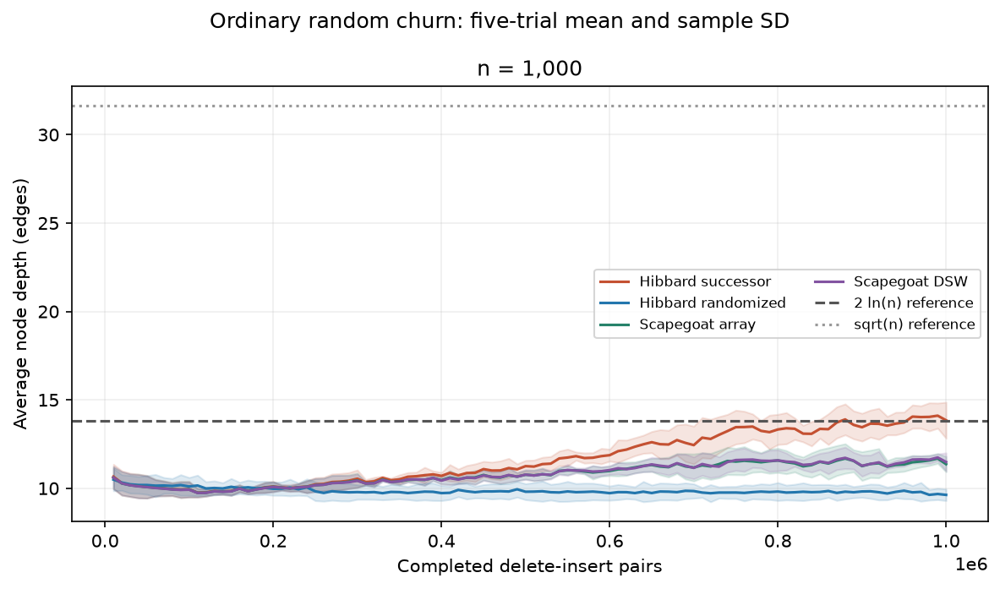
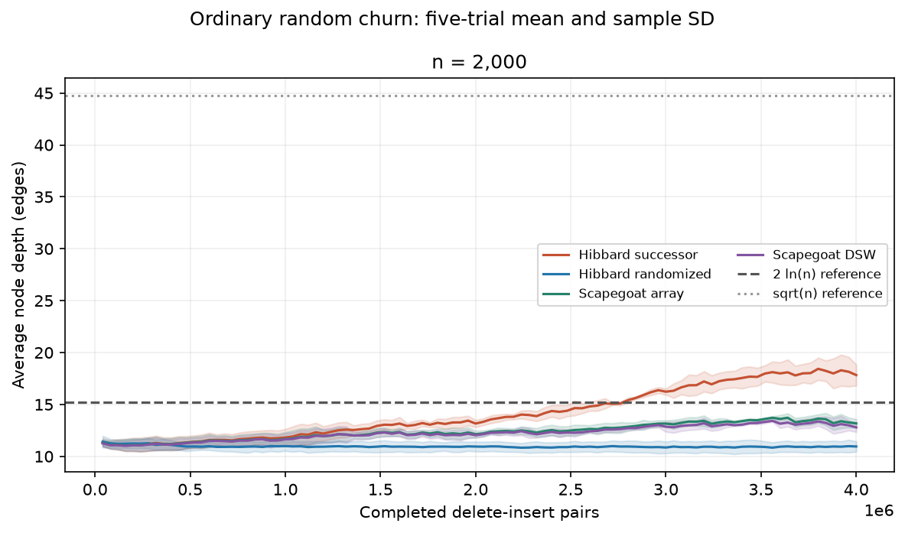

Lines show trial means and shading shows one sample SD. The two horizontal references are constant within each fixed-n run. The C++ runner also exports standalone SVG mean curves for each new study. For targeted workloads use the team's [adversarial results](adversary/RESULTS.md), which distinguishes reference and upstream implementations. The Windows cache tracer did not return usable counters. Run the cache-profiling commands in [the analyst guide](bench/ANALYST_GUIDE.md) before adding cache conclusions.

Figure captions: the three ordinary-churn figures above show five-trial mean
node depth with one sample SD, plus 2 ln(n) and sqrt(n) reference curves.
Source: `results/raw/analyst/random-raw.csv`; generator:
`python scripts/plot_results.py`. The references are constant for fixed n.

The reference targeted workloads are shown below. Each panel uses five trials,
with n² pairs at the labelled size; shaded bands show one sample SD. These
figures use the separate reference implementation and must not be relabelled
as new integrated-main timing evidence.

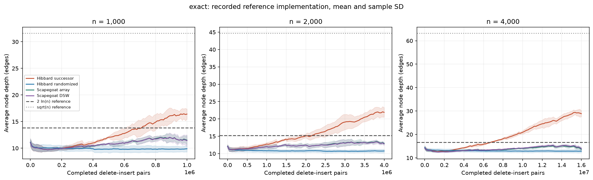

Source: `results/raw/adversary/exact-*.csv`; script: `scripts/plot_results.py`.
The uniform exact-fit trajectory grows less than the shallow-targeted schedule.

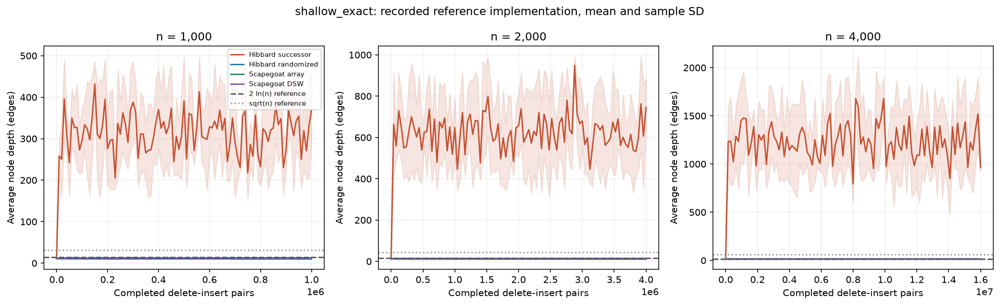

Source: `results/raw/adversary/shallow_exact-*.csv`; script: `scripts/plot_results.py`.
The targeted successor tree develops much greater depth under this finite experiment.

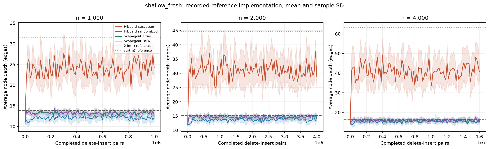

Source: `results/raw/adversary/shallow_fresh-*.csv`; script: `scripts/plot_results.py`.
Fresh-key targeting also increases successor depth, but less than biased exact fit.

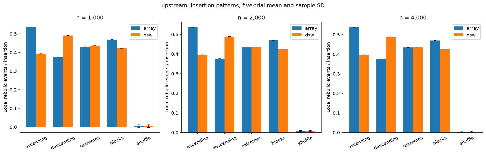

Source: `results/raw/adversary/insertions-upstream-*.csv`; script:
`scripts/plot_results.py`. Bars are five-trial mean event frequency with sample
SD. Ascending/descending patterns are strong tested cases; rebuilt work and
time are reported separately in the insertion summary.

### Which schedule degrades the successor tree fastest?

Final depth alone cannot distinguish a schedule that builds a long path early from one that reaches it near the end. The reference study also measured the area under the depth trajectory divided by the pair count and the first sampled crossing of 1.5 times initial depth. At 4,000 keys, shallow exact-fit crossed that threshold in all five runs by the first sampled checkpoint (160,000 pairs). Uniform exact-fit crossed it in all five runs at a mean first crossing of 10,688,000 pairs. Mean depth over the run was 1,229.975 versus 19.414. Deletion high in the tree exposes large descendant subtrees to repeated one-sided replacements. Reusing the deleted rank lets the displaced key return through ordinary leaf insertion.

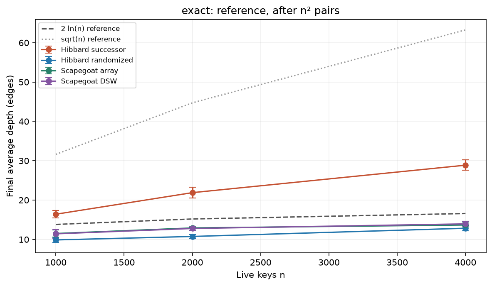

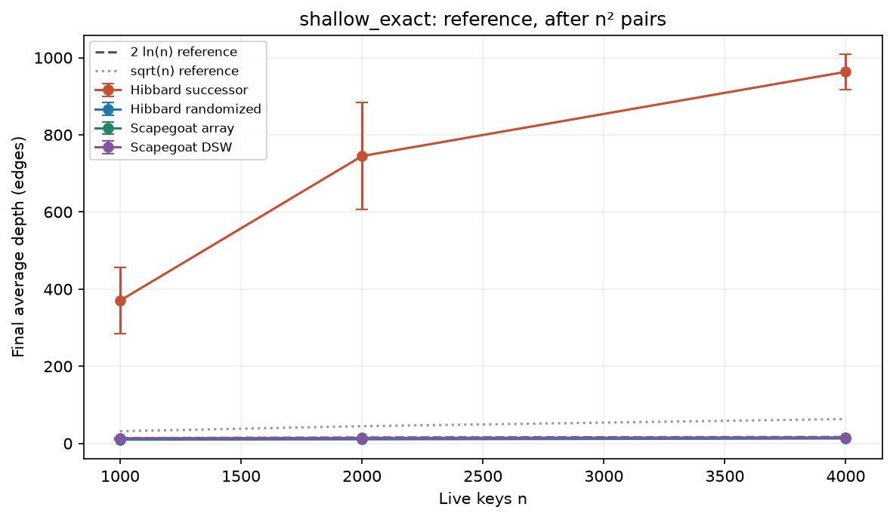

In the fresh-key comparison at the same population, targeting shallow two-child nodes raised mean depth over the run from 16.989 to 40.855 for always-successor. The schedule still changed shape, but less severely than targeted exact fit. This difference matters when interpreting a workload in which deleted keys seldom return. The most damaging of the tested schedules depends on the allowed replacement rule.

### Which insertion order triggers the most rebuilds?

At 4,000 insertions into the upstream implementation, ascending order produced 2,149 array rebuilds (0.53725 per insertion). Descending order produced 1,957 DSW rebuilds (0.48925 per insertion). These two patterns led their respective modes at the smaller sizes as well. Monotone arrival keeps extending an outside search path until the depth threshold is crossed. The two methods can then leave different shapes, so the next trigger can arrive at a different insertion.

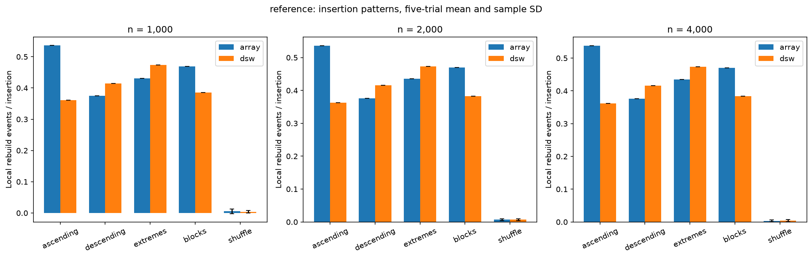

In that reference implementation, alternating extremes led the DSW comparison at 4,000 keys (0.47325 events per insertion). This is a concrete reason to preserve implementation labels when comparing graphs. An event can rebuild a small subtree or almost the whole tree. Frequency identifies the winner for the stated adversarial target; total nodes rebuilt and rotations answer the separate question of work.

### When randomized Hibbard has lower mean depth

The Scapegoat trigger constrains the longest insertion path. It allows many legal shapes at the same population, and does not minimize the sum of all depths after each update. Choosing predecessor or successor randomly also avoids repeatedly favoring the same side. The ordinary-churn result at alpha = 0.7 is therefore plausible: randomized Hibbard had lower final mean depth than either rebuilding method at all three measured sizes.

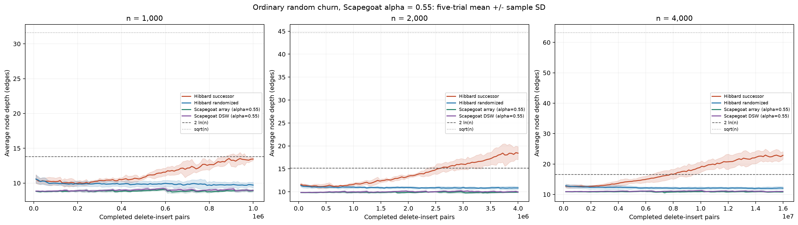

| Keys | Always successor | Randomized Hibbard | Array rebuild | DSW rebuild |
| ---: | ---: | ---: | ---: | ---: |
| 1,000 | 13.45 | 9.72 | 8.91 | 8.95 |
| 2,000 | 18.41 | 10.83 | 9.93 | 9.95 |
| 4,000 | 22.85 | 12.07 | 10.83 | 10.99 |

Entries are five-trial means of final average depth, in edges. The alpha = 0.55 follow-up ran in a Linux container with GCC 14.2.0. Its archived 4,000-key first trial combines three completed strategy series with a separately rerun DSW series using the same seed and trace hash. A subsequent full replay reproduced the recorded depths. This follow-up selected alpha = 0.55 after exploration and used workload seeds 20261118 through 20261122 at each size. At the tighter setting both Scapegoat variants had lower final mean depth than randomized Hibbard. Within each study the strategies shared traces. Between studies the seeds also changed, so the numerical difference cannot isolate the effect of alpha. A paired parameter comparison would hold each workload and policy seed fixed while varying only alpha.

### Reproducing the comparison

From a clean checkout with the documented C++ toolchain and Python dependencies, run `python scripts/run_all.py`. This builds the binaries, runs the tests, executes the full default study, and regenerates the figures. For the separate parameter study run `python scripts/run_alpha055.py` after the build and point `scripts/plot_alpha055.py --input` at the new trial directory. To regenerate only the published figures, use `python scripts/run_all.py --figures-only`.

Revision 03f2c8c passed all ten registered tests. Across each study's 6,000 strategy-checkpoint rows, an independent clean-checkout replay matched the submitted trace hashes, heights and numeric average depths. These are deterministic comparisons. The original machine's latency measurements remain the timing evidence. The historical targeted-churn figures can be regenerated from their raw CSVs without rerunning the separate reference implementation.

### Additional figures and independent replay

The reference ordinary-churn series provides the control for the targeted schedules. Comparing uniform and shallow deletion at the same population distinguishes the cost of a directional replacement policy from the additional effect of targeting its shallow two-child nodes.

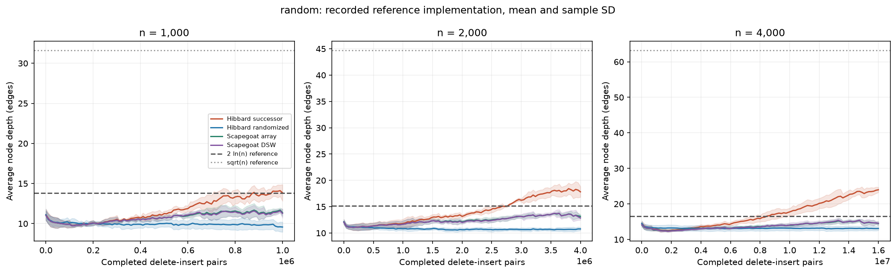

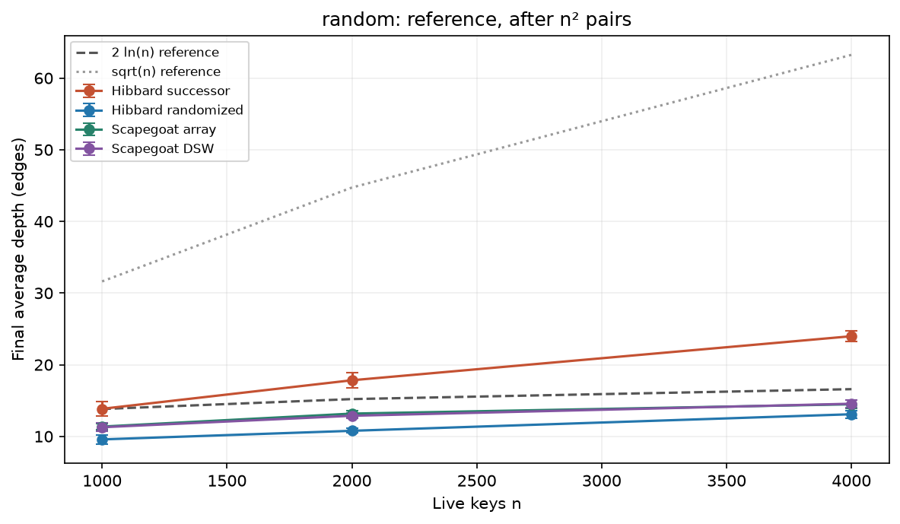

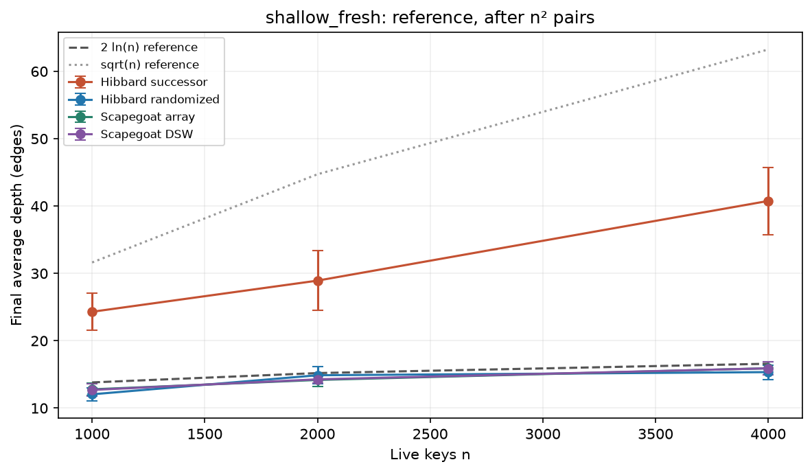

The independent analyst replay provides one vector figure per population. Its axes and policies match the primary study, so each panel can be checked against its counterpart in the main results.

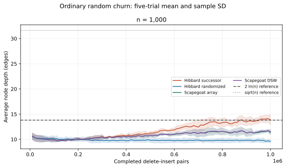

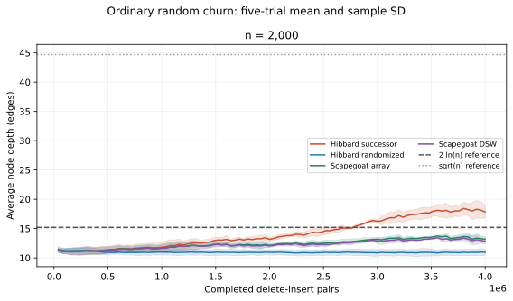

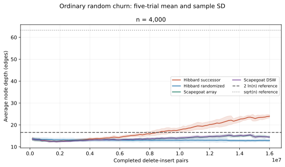

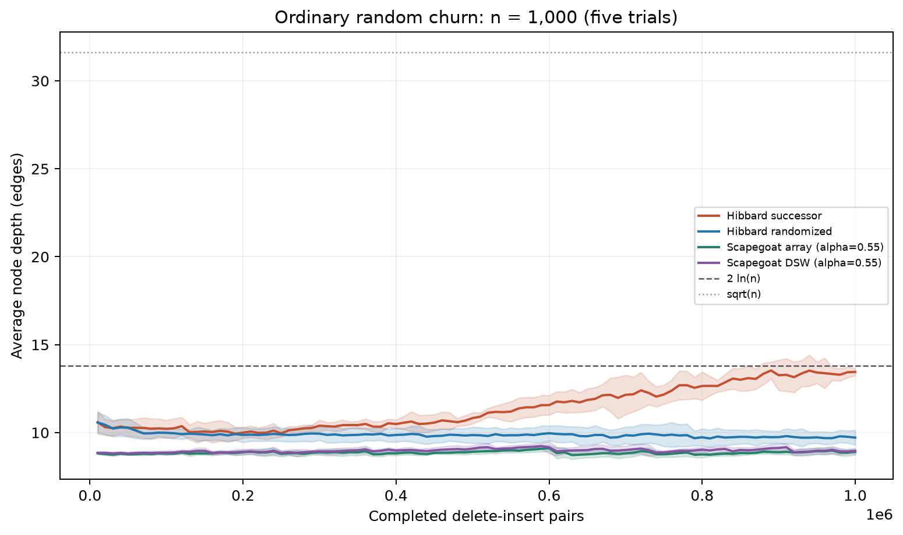

The [vector edition of the three-population follow-up](results/figures/analyst/alpha055-random/ordinary-random-alpha055-three-populations.svg) contains the same panels as its PNG edition shown above.

## 12. Limitations

Three finite populations and n²-pair runs do not establish an asymptotic law.
Reference and integrated measurements use different implementations and machines.
No hardware cache conclusions or globally optimal adversarial schedule are claimed.
The historical full reference benchmark is not self-contained in this repository;
the raw measurements and their figures are reproducible as data transformations.

This report is structured for team review, not a claim that the final submission
is complete. Author verification of derivation page limits and
identity details, remaining tool-version/prompt records, instructor I/O agreement
and release tagging remain on [the checklist](docs/SUBMISSION_CHECKLIST.md).
The report PDF is generated from this Markdown; regenerate it after revisions.

## 13. References

- Hibbard (1962), Some Combinatorial Properties of Certain Trees with Applications to Searching and Sorting.
- Eppinger (1983), An Empirical Study of Insertion and Deletion in Binary Search Trees.
- Culberson (1985), The Effect of Updates in Binary Search Trees, STOC. DOI 10.1145/22145.22168.
- Culberson and Munro (1990), Analysis of the Standard Deletion Algorithms in Exact Fit Domain Binary Search Trees, Algorithmica 5, 295-311.
- Galperin and Rivest (1993), Scapegoat Trees, SODA, 165-174.
- Stout and Warren (1986), Tree Rebalancing in Optimal Time and Space, CACM 29(9), 902-908.
- Bayer and McCreight (1972), Organization and Maintenance of Large Ordered Indexes.
- Sedgewick, Mathematical Analysis of Combinatorial Algorithms, chapter 8, Trees.

Detailed citations appear in the authored D1-D6 derivations. Local technical
sources are [INTERFACE.md](INTERFACE.md), [Oracle verification](oracle/VERIFICATION.md),
[adversary results](adversary/RESULTS.md), and the Analyst prediction record.
Tool records are in [TOOLS.md](TOOLS.md) and [TOOLS_ARCHITECT.md](TOOLS_ARCHITECT.md).
