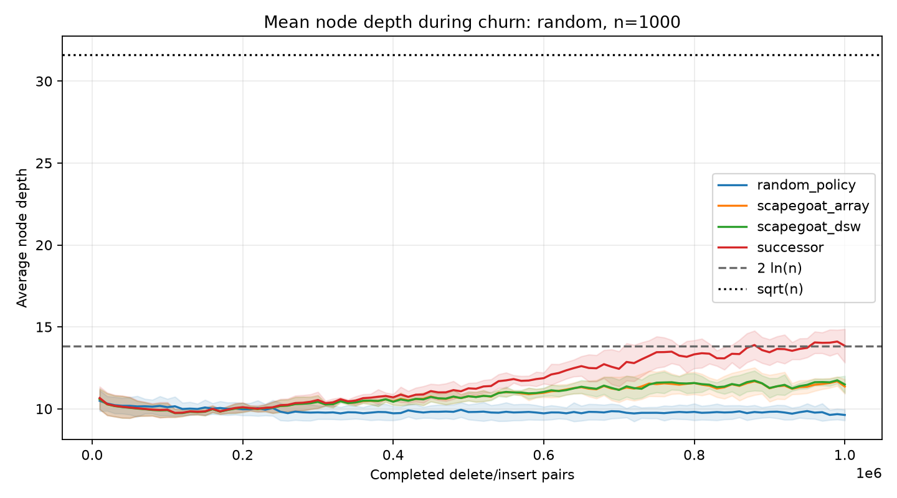
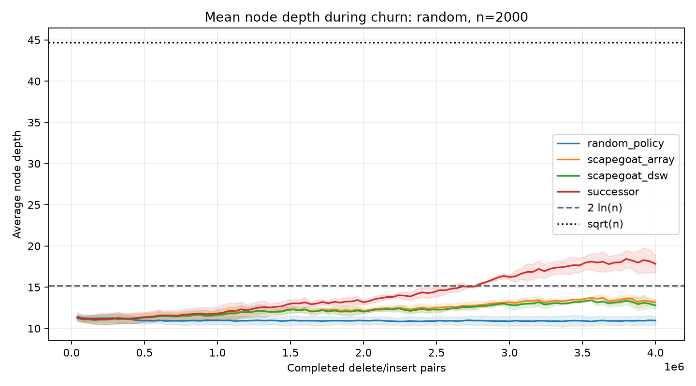
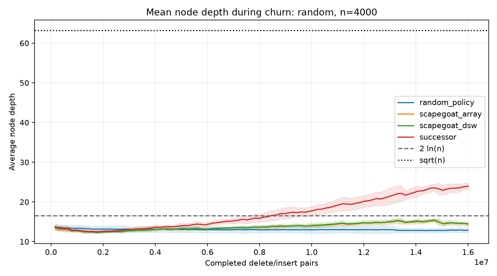

# Project results and verification

## Analyst results for ordinary random churn

Five seeds at each size, 100 checkpoints per trial, four strategies on identical traces and n squared pairs per trial. Source for timing was the separate development checkout at revision 778c6d4. Compiler was Zig 0.14.1 c++ with C++17, -O2 and -DNDEBUG. The machine was a Ryzen 7 7840HS running Windows 11 build 26300, with aggregate L1/L2/L3 capacities reported as 512 KiB, 8 MiB and 16 MiB. Native timing excludes setup, validation and depth scans. See [the summary](results/analyst/random-summary.csv) for every mean and sample SD, and [the raw checkpoints](results/analyst/random-raw.csv) for seeds and trace hashes.

| Live keys | Successor depth | Random-policy depth | Array depth | DSW depth | Forecast local events per pair | Observed array / DSW |
|---:|---:|---:|---:|---:|---:|---:|
|1000|13.84|9.63|11.36|11.49|2.73%|0.526% / 0.521%|
|2000|17.83|10.95|13.17|12.79|2.42%|0.505% / 0.406%|
|4000|23.98|12.87|14.48|14.44|2.14%|0.364% / 0.349%|

The random-tree approximation overestimated local events at every size. It assumes a random-insertion shape after deletion. Rebuilding changes that shape and suppresses deep gaps. Zero whole-tree rebuilds matched the fixed-population prediction. At 4000 keys the successor and random-policy final depths were 23.98 ± 0.73 and 12.87 ± 0.59. This supports the direction of Eppinger's observation over the measured horizon. Three finite sizes under fresh-key churn cannot establish the square-root law proved for restricted exact fit.

At 4000 keys mean ns per operation (sample SD) were 79.40 (4.15) for successor, 69.91 (3.59) for random policy, 85.79 (10.54) for array and 82.12 (4.00) for DSW. Depth alone cannot explain the cost of rebuilding, allocation and pointer updates. The scatter does not establish a universal speed ranking.

Lines show trial means and shading shows one sample SD. The two horizontal references are constant within each fixed-n run. The C++ runner also exports standalone SVG mean curves for each new study. For targeted workloads use the team's [adversarial results](adversary/RESULTS.md), which distinguishes reference and upstream implementations. The Windows cache tracer did not return usable counters. Run the cache-profiling commands in [the analyst guide](bench/ANALYST_GUIDE.md) before adding cache conclusions.

## Oracle verification and D4 — Sai

A sorted vector gives an independent answer for signed 64-bit set membership, updates and cardinality. At every operation the harness compares each of the four strategies with that answer. Full audits compare the complete inorder sequence, check BST ordering and count, and check the scapegoat height and deletion-shrink conditions. Structure B exposes a void insertion method, so duplicate and new insertions are distinguished by post-state. The set can agree while tree depths differ.

At the tested main revision 2dcde34 the one-million-operation mixed run passed with workload seed 20261117 and randomized Hibbard policy seed 253. For ordinary churn, seed 42 passed 1, 4 and 16 million delete–insert pairs at n = 1000, 2000 and 4000 respectively across four variants. Dedicated fixtures covered boundary keys and no-op updates. In a disposable modified build, an incorrect size after erasing 17 reduced from eight operations to two. This was an intentional test of the harness. [Commands and evidence](oracle/VERIFICATION.md)

For random insertion, conditioning on the root rank gives expected internal path length P(n) = n−1 + (2/n) times the sum of P(k) for 0 ≤ k < n. The recurrence gives expected average depth 2(1+1/n)H(n)−4, asymptotically 2 ln n. Enumeration on the actual Hibbard implementation agrees for every size 1 through 8. This provides a baseline at initialization. [D4 proof by Sai](docs/derivations/D4.pdf)
