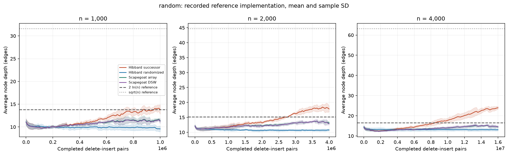
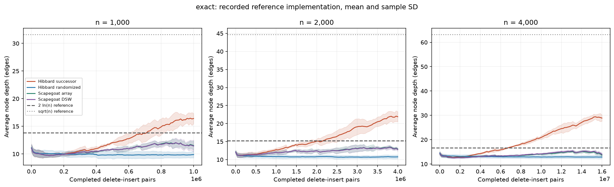
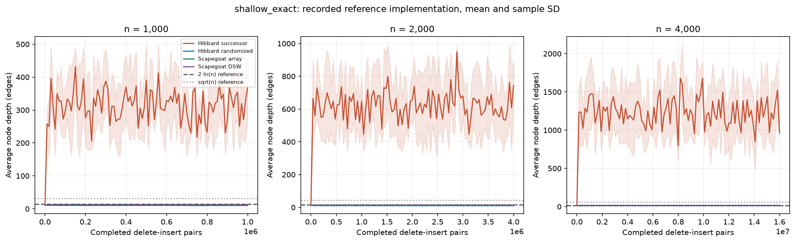
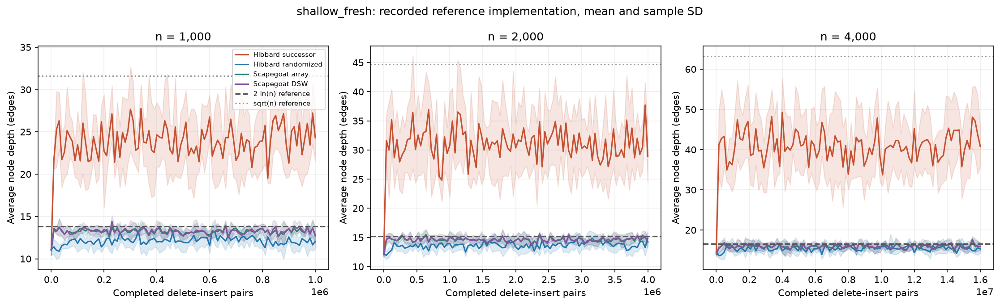
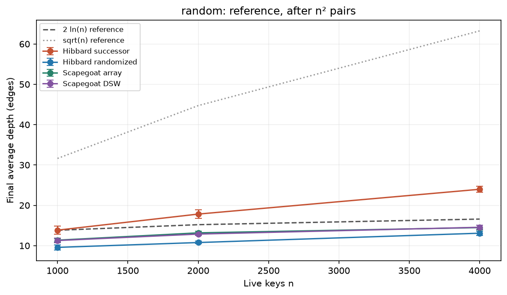
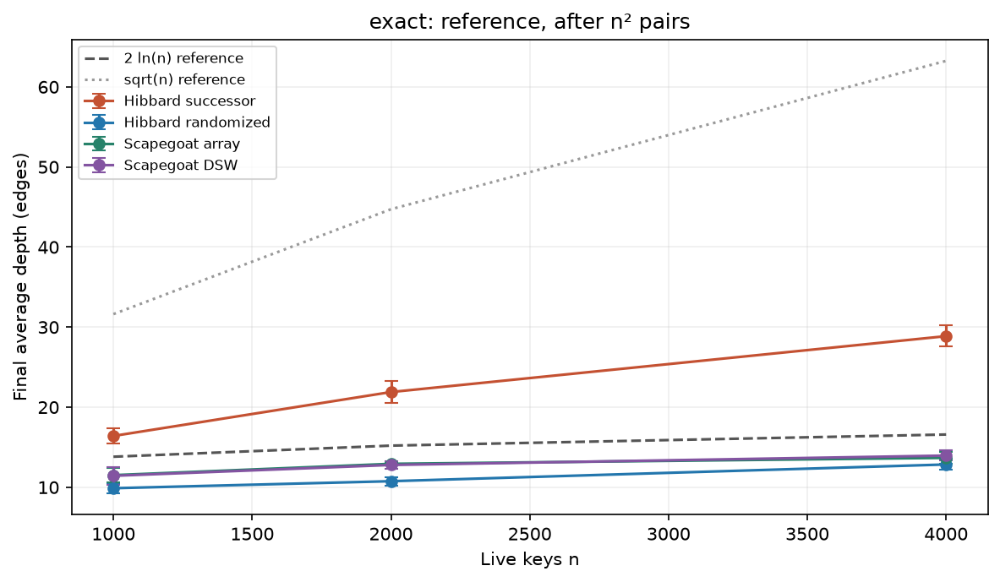
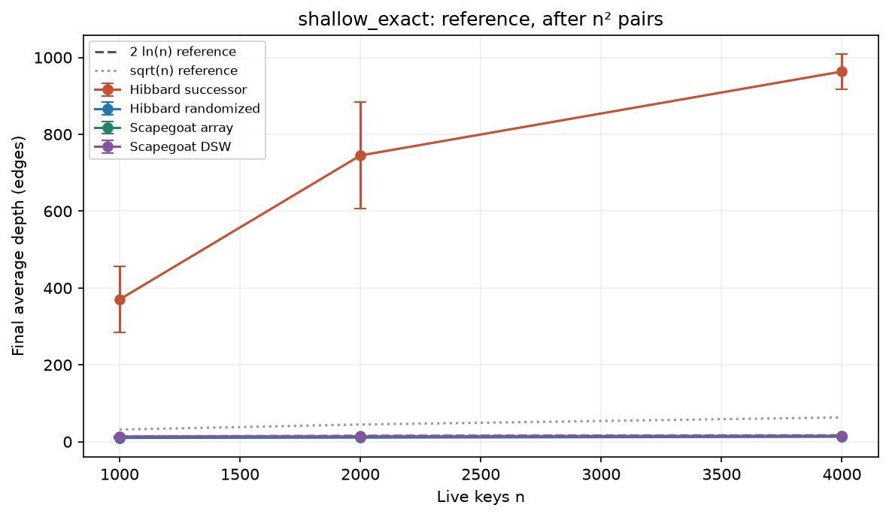
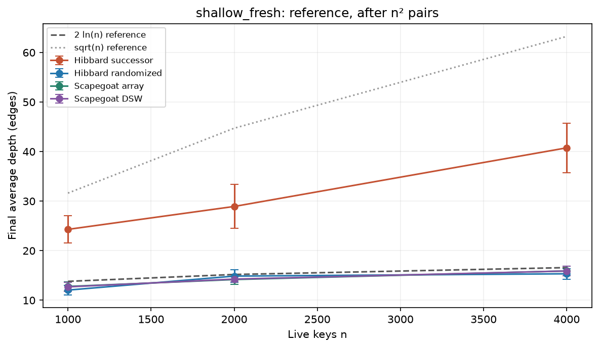
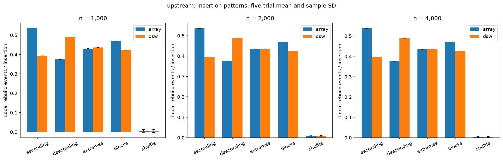
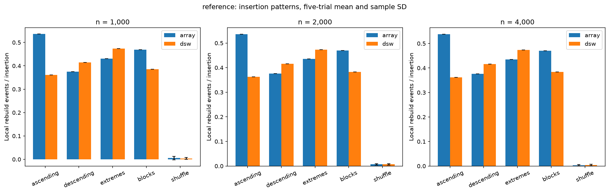

# Adversarial results: Project 3

Measured reference experiments, 16 November 2026. No global optimality or ordinary-churn asymptotic theorem is claimed.

## Evidence and experimental design

The full dataset has 60 churn runs: four workloads, three populations (1000, 2000, 4000), five independent evaluation seeds each. Every run executes n squared delete/insert pairs against four strategies, giving 420000000 generated pairs and 1680000000 strategy-pair replays. Initialization order and each replay block are identical across strategies. A sorted-array oracle validates every generated pair; every checkpoint audits full tree contents and invariants. Trial seeds are 202611160 + 31*n + trial; policy seed is workload_seed XOR 0x504f4c494359. Initial and cumulative trace hashes are in every CSV.

The interrupted partial n=4000 shallow_exact trial is retained under results/interrupted with its checksum in the manifest. Only that incomplete trial was restarted; completed runs were hash-verified and retained. The partial run is excluded from reported aggregates.

Raw insertion experiments additionally have 30 runs: unchanged upstream and reference Scapegoat implementations, three sizes and five trials, each covering five patterns and two rebuild modes at alpha=0.7. The original teammate code uses basic left-packed Stout-Warren compression; the reference uses perfect-leaves. These are distinct implementations, explicitly labeled.

The predictor in bench/PREDICTIONS.md was recorded before the pilot or reported runs. The pilot seed 2001 was used only for development and is excluded from results/raw and the reported aggregates. Setup, generation, oracle checks and checkpoint scans are excluded from churn timings. Each block is timed with steady_clock; replay order rotates across blocks/trials. No CPU affinity or hardware-counter profiling was used.

## Always-successor degradation

| Workload | n | Final mean depth ± sample SD | Mean depth increase | Mean depth over run | Runs reaching 1.5x initial depth | Mean first crossing pairs (if reached) |
| --- | ---: | ---: | ---: | ---: | ---: | ---: |
| exact | 1000 | 16.409 ± 0.951 | 5.294 | 12.429 | 1/5 | 680000 |
| random | 1000 | 13.845 ± 1.022 | 2.730 | 11.624 | 0/5 | not reached |
| shallow_exact | 1000 | 370.173 ± 86.153 | 359.058 | 312.921 | 5/5 | 10000 |
| shallow_fresh | 1000 | 24.303 ± 2.781 | 13.188 | 23.901 | 5/5 | 10000 |
| exact | 2000 | 21.893 ± 1.396 | 9.758 | 15.689 | 5/5 | 2936000 |
| random | 2000 | 17.829 ± 1.013 | 5.694 | 14.107 | 4/5 | 3500000 |
| shallow_exact | 2000 | 744.887 ± 138.744 | 732.752 | 622.295 | 5/5 | 40000 |
| shallow_fresh | 2000 | 28.928 ± 4.448 | 16.793 | 31.057 | 5/5 | 40000 |
| exact | 4000 | 28.872 ± 1.314 | 14.336 | 19.414 | 5/5 | 10688000 |
| random | 4000 | 23.977 ± 0.735 | 9.441 | 16.989 | 5/5 | 13568000 |
| shallow_exact | 4000 | 963.345 ± 45.345 | 948.809 | 1229.975 | 5/5 | 160000 |
| shallow_fresh | 4000 | 40.758 ± 4.974 | 26.222 | 40.855 | 5/5 | 160000 |

Crossing is the first sampled checkpoint, not an exact first-passage time. Mean depth over run is the trapezoidal area divided by pair count. These metrics distinguish an early attack from a high final depth. The shallow generators prefer two-child nodes within depths 0..3 in an independent always-successor shape model. Their biased deletion is outside the uniform-selection assumption of the exact-fit theorem.

## Prediction against measurement

At n=1000, shallow_exact has the largest mean depth-over-run among the four tested schedules. shallow_exact/exact area ratio is 25.18; shallow_fresh/random is 2.06. These values support the exact-fit acceleration hypothesis and support the fresh-key acceleration hypothesis for this tested size and metric.

At n=2000, shallow_exact has the largest mean depth-over-run among the four tested schedules. shallow_exact/exact area ratio is 39.67; shallow_fresh/random is 2.20. These values support the exact-fit acceleration hypothesis and support the fresh-key acceleration hypothesis for this tested size and metric.

At n=4000, shallow_exact has the largest mean depth-over-run among the four tested schedules. shallow_exact/exact area ratio is 63.36; shallow_fresh/random is 2.40. These values support the exact-fit acceleration hypothesis and support the fresh-key acceleration hypothesis for this tested size and metric.

Depth bias can carry into fresh-key churn, but its size depends on key distribution, update order and targeting. An exact-fit biased schedule can be much worse than the random exact-fit expectation without contradicting Culberson-Munro. Three finite sizes, reference implementations and n squared finite trajectories cannot establish a stationary distribution or asymptotic exponent. The sqrt(n) and 2 ln(n) curves in figures are unscaled references, not fitted laws.

## Strategy comparison at n=4000

| Workload | Strategy | Final depth ± SD | ns/operation mean ± SD | Rebuilds/pair | Rebuilt nodes/pair | Rotations/pair |
| --- | --- | ---: | ---: | ---: | ---: | ---: |
| exact | random_policy | 12.847 ± 0.690 | 364.13 ± 18.90 | 0.000000 | 0.0000 | 0.0000 |
| exact | scapegoat_array | 13.674 ± 0.724 | 415.77 ± 18.20 | 0.000959 | 0.0070 | 0.0000 |
| exact | scapegoat_dsw | 13.958 ± 0.623 | 414.55 ± 18.02 | 0.001028 | 0.0073 | 0.0089 |
| exact | successor | 28.872 ± 1.314 | 409.60 ± 13.98 | 0.000000 | 0.0000 | 0.0000 |
| random | random_policy | 13.087 ± 0.549 | 421.09 ± 12.64 | 0.000000 | 0.0000 | 0.0000 |
| random | scapegoat_array | 14.479 ± 0.603 | 486.60 ± 13.13 | 0.003638 | 0.0255 | 0.0000 |
| random | scapegoat_dsw | 14.555 ± 0.521 | 485.85 ± 19.52 | 0.003606 | 0.0253 | 0.0329 |
| random | successor | 23.977 ± 0.735 | 446.87 ± 26.30 | 0.000000 | 0.0000 | 0.0000 |
| shallow_exact | random_policy | 12.983 ± 0.574 | 288.07 ± 8.31 | 0.000000 | 0.0000 | 0.0000 |
| shallow_exact | scapegoat_array | 14.861 ± 0.721 | 580.21 ± 15.40 | 0.381662 | 9.9287 | 0.0000 |
| shallow_exact | scapegoat_dsw | 15.018 ± 0.238 | 575.34 ± 15.00 | 0.256860 | 9.4817 | 16.4613 |
| shallow_exact | successor | 963.345 ± 45.345 | 21436.74 ± 393.27 | 0.000000 | 0.0000 | 0.0000 |
| shallow_fresh | random_policy | 15.345 ± 1.066 | 394.34 ± 5.10 | 0.000000 | 0.0000 | 0.0000 |
| shallow_fresh | scapegoat_array | 15.914 ± 0.997 | 485.86 ± 11.69 | 0.015902 | 1.3935 | 0.0000 |
| shallow_fresh | scapegoat_dsw | 15.907 ± 0.989 | 502.43 ± 6.86 | 0.014341 | 1.3422 | 2.5742 |
| shallow_fresh | successor | 40.758 ± 4.974 | 551.64 ± 5.71 | 0.000000 | 0.0000 | 0.0000 |

All fixed-size runs reported zero deletion-triggered whole-tree rebuilds, as expected: with alpha=0.7 and max_n=n, n-1 is not below alpha*n at these sizes. Separate deletion-to-empty and strict-threshold fixtures exercise whole-tree rebuilding. Frequent small rebuilds and costly large rebuilding are separate effects; inspect rebuilt nodes and rotations rather than ranking costs by events alone.

The cost sketch predicts logarithmic amortized Scapegoat update work, not a constant event rate. Finite-size shape, alpha, depth gating and repeat insertions explain why its heuristic local frequency model is not a numerical guarantee. The reference array and perfect-leaves shapes can still differ by median choices, so equal input hashes do not imply equal event counts.

## Insertion target: highest observed event frequency

| Implementation | n | Rebuild mode | Highest-frequency tested patterns (ties retained) | Events/insertion |
| --- | ---: | --- | --- | ---: |
| upstream | 1000 | array | ascending | 0.536000 |
| upstream | 1000 | dsw | descending | 0.491000 |
| upstream | 2000 | array | ascending | 0.535500 |
| upstream | 2000 | dsw | descending | 0.489000 |
| upstream | 4000 | array | ascending | 0.537250 |
| upstream | 4000 | dsw | descending | 0.489250 |
| reference | 1000 | array | ascending | 0.536000 |
| reference | 1000 | dsw | extremes | 0.474000 |
| reference | 2000 | array | ascending | 0.535500 |
| reference | 2000 | dsw | extremes | 0.473500 |
| reference | 4000 | array | ascending | 0.537250 |
| reference | 4000 | dsw | extremes | 0.473250 |

These are maxima among five tested pattern families, not among all permutations. Seed affects shuffle; deterministic patterns have repeated identical traces but independently repeated timing runs. Raw data separately record event counts, rebuilt nodes, rotations, depths and timing. No claim that the frequency winner is the slowest pattern is implied.

## Reproducibility and limits

The measured machine was an Intel Core i7-14700HX (20 cores, 28 logical processors), Windows 11 Home Single Language 10.0.26300; Windows-reported L2/L3 totals were 28672/33792 KiB. g++ 16.2.0 used -std=c++17 -O2 -Wall -Wextra -Wpedantic. See machine.json for provenance. Timings are unpinned and subject to scheduler, frequency, background-load and allocator variation. No cache locality or cache-miss claim is made; no profiler data were collected.

Full churn results require the separately staged reference project because the measured base snapshot of teammate Structure A lacks deletion and depth APIs. The contribution includes the input generators, unchanged-upstream Scapegoat measurement driver, raw results and source hashes, but intentionally excludes other roles' draft implementations. Use the reference project in the general folder to reproduce full churn; integration into the team simulator still requires the owners' API work and review. The public contribution is not the complete final team release.

The source hashes and CSV SHA-256 values are checked by the reference audit. Generator checks passed 200000 pairs plus CLI round trips. The reference differential harness passed 1000000 seeded operations across four strategies, with audits after every operation. A deliberately faulty dropped-erase test double was shrunk to insert 13 / delete 13 and independently checked 1-minimal. This fixture demonstrates the shrinker, not a real discovered tree defect.

## Sources

[Culberson and Munro (1990)](https://www.ime.usp.br/~yoshi/2012i/mac323/exx/ST_ABB_Evolution/culberson_Algo.pdf): restricted exact-fit theorem. [Eppinger (1983)](https://rtheunissen.github.io/bst/docs/references/1983_eppinger.pdf): empirical ordinary-churn motivation. [Galperin and Rivest (1993)](https://people.csail.mit.edu/rivest/pubs/GR93.pdf): Scapegoat algorithm and amortized analysis. [Stout and Warren (1986)](https://web.eecs.umich.edu/~qstout/pap/CACM86.pdf): in-place rebuilding and balance variants.

## Figures

Compatibility review (16 November 2026): `mayank/adversary` at `df8e899` passed integration checks against `main` at `6633c5c`. The earlier Structure A duplicate-definition issue was fixed in `1a59bb1`. Current APIs include `metrics().average_depth()`, `inorder()` and `validate()`. The published timing data still describes the recorded reference snapshot, not a new performance study of main.
